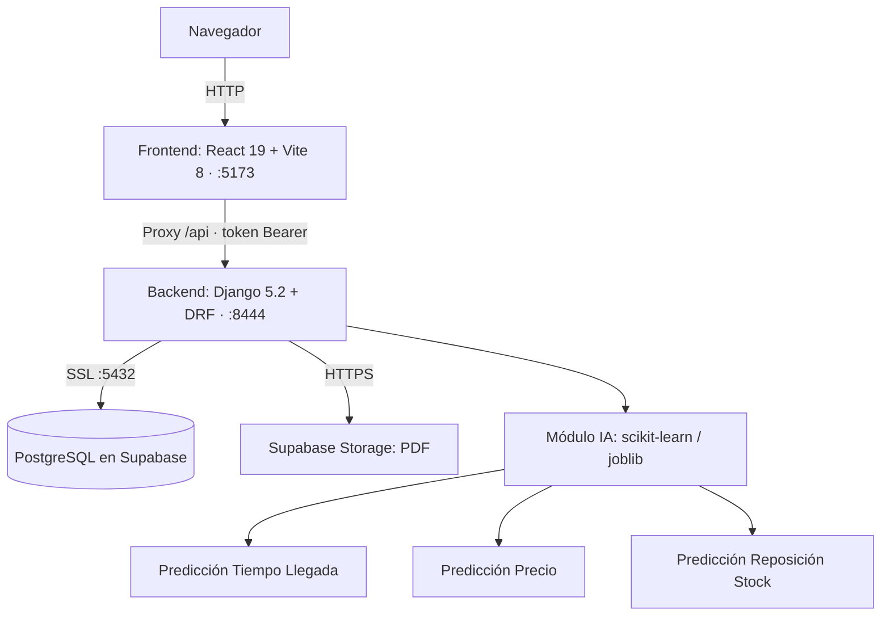

# 🌍 EcoTerra — Sistema de Gestión Operativa, Facturación e Inteligencia Artificial

-4169E1?style=for-the-badge&logo=postgresql&logoColor=white)

  <b>Sistema integral para la centralización de clientes, inventario, cotizaciones, facturación y análisis predictivo en el control de polvo y estabilización de caminos.</b>

[📌 Descripción](#-descripción-general) •
[✨ Módulos](#-módulos-y-funcionalidades) •
[🤖 IA](#-modelos-de-inteligencia-artificial) •
[🏗️ Arquitectura](#️-arquitectura-del-sistema) •
[🚀 Instalación](#-instalación-y-configuración) •
[🧪 Pruebas](#-ejecución-de-pruebas) •
[🛟 Problemas](#-solución-de-problemas)

---

## 📌 Descripción General

**EcoTerra** es una empresa especializada en soluciones con polímeros para el control de polvo y la estabilización de caminos en áreas industriales y mineras. Parte de sus productos son adquiridos en Estados Unidos y trasladados a Chile vía transporte marítimo.

Este proyecto corresponde a un **Sistema de Gestión de Inventario, Cotizaciones, Facturación y Predicciones con IA**, diseñado para centralizar la operación logística y comercial, permitiendo una toma de decisiones informada basada en modelos analíticos.

> **Proyecto APT — Capstone**, Ingeniería en Informática. Este README es la versión breve del [manual técnico](docs/06_despliegue/manual_tecnico.pdf).

---

## ✨ Módulos y Funcionalidades

### 📦 1. Gestión Operativa e Inventario
* **Clientes y Direcciones:** Registro de clientes y soporte para múltiples direcciones de despacho.
* **Productos y Lotes:** Control de características, envases, ubicación y fechas de fabricación/vencimiento.
* **Control de Inventario:** Existencias en tiempo real y movimientos de entrada, salida y ajuste.
* **Gestión de Proveedores:** Operaciones CRUD.
* **Usuarios y Seguridad:** Autenticación con token Bearer (8 h) y control de acceso por roles y permisos.

### 📄 2. Cotizaciones y Facturación
* **Ciclo Comercial:** Cotizaciones, vinculación con Órdenes de Compra (con detección automática desde PDF) y generación de facturas.
* **Documentos:** Facturas detalladas y notas de crédito asociadas.
* **PDF seguros:** Documentos comerciales generados con ReportLab y almacenados en Supabase Storage.
* **Notificaciones:** Envío de cotizaciones y facturas por correo electrónico.

### 🧠 3. Módulo de Inteligencia Artificial
* Modelos predictivos de apoyo a la gestión comercial y a la reposición de stock, expuestos como endpoints de la API.

---

## 🤖 Modelos de Inteligencia Artificial

Desarrollados en **Python** con **scikit-learn**, **pandas** y **joblib** (`backend/predicciones/`):

| Modelo | Entradas (Features) | Salida (Target) | Endpoint |
| :--- | :--- | :--- | :--- |
| **⏱️ Tiempo de Llegada** | Puerto de origen, Naviera, Tipo de carga, Mes | Días estimados de arribo | `/api/predicciones/llegada/` |
| **💰 Predicción de Precio** | Producto, Fecha, Cantidad | Precio esperado (CLP/USD) | `/api/predicciones/precio/` |
| **📊 Reposición de Stock** | Stock actual, Ventas promedio, Stock mínimo | Días antes del desabastecimiento | `/api/predicciones/stock/` |

---

## 🏗️ Arquitectura del Sistema

Aplicación web cliente-servidor por capas. El frontend (SPA en React) consume una API REST en Django REST Framework, que persiste los datos en PostgreSQL (Supabase) y guarda los PDF en Supabase Storage. El módulo de IA se ejecuta dentro del backend.

| Componente | Tecnología | Ubicación |
| :--- | :--- | :--- |
| Frontend | React 19, TypeScript 5.7, Vite 8, Tailwind CSS 4 | `src/`, `Dockerfile` |
| Backend / API | Python, Django 5.2, DRF 3.16, django-cors-headers | `backend/` (usuarios, clientes, inventario, proveedores, cotizaciones, facturacion, ventas, predicciones) |
| Base de datos | PostgreSQL en Supabase (psycopg 3); SQLite solo en pruebas | `backend/config/settings.py`, `scripts/*.sql` |
| Documentos | ReportLab (generación) y pypdf (lectura de OC) | `backend/cotizaciones/pdf.py`, `backend/ventas/deteccion_oc.py` |
| IA | scikit-learn, pandas, joblib | `backend/predicciones/` |
| Contenedores | Docker + Docker Compose | `docker-compose.yml`, `Dockerfile`, `backend/Dockerfile` |
